# SentinelOps

[](https://github.com/jui-dev/SentinelOps/actions/workflows/ci.yml)
[](LICENSE)


**Incident management for engineering teams.** Declare an incident when something breaks,
get the right people working on it, resolve it with a record of what happened, and learn
from it afterwards.

SentinelOps is a full-stack TypeScript monorepo — a NestJS API on PostgreSQL and a
Next.js web app — built around one idea: every incident follows the same path, and each
step belongs to a clear role.

<p align="center">
  <a href="#screenshots">Screenshots</a> ·
  <a href="#getting-started">Run it locally</a> ·
  <a href="docs/architecture.md">Architecture</a> ·
  <a href="docs/security.md">Security</a>
</p>

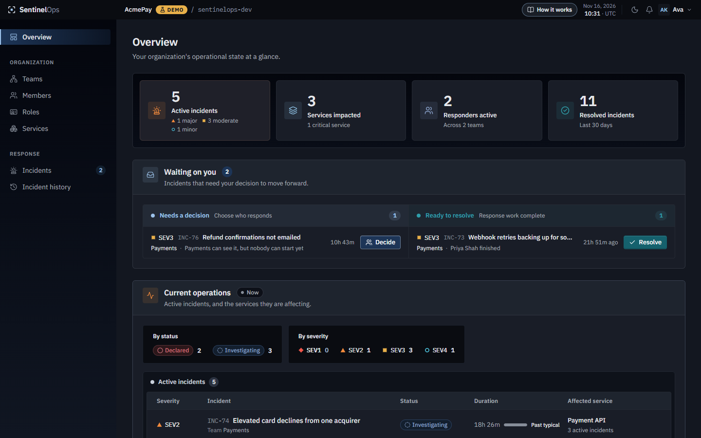

---

## How an incident works

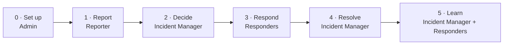

| Step | What happens |
| --- | --- |
| **Set up** | The Admin adds people with one-time passwords, puts them on teams, and records the services each team owns. |
| **Report** | A Reporter — or an Incident Manager or Admin — declares an incident against the affected service and suggests a severity (SEV1–SEV4). Recurring problems can be picked from the service's known issues. |
| **Decide** | An Incident Manager confirms the severity and chooses who responds: the whole owner team, or named people. |
| **Respond** | Responders start investigating, post updates to the incident's timeline, and mark their own part complete. |
| **Resolve** | Once every responder who started has finished, the incident is resolved with a note on how it was fixed. |
| **Learn** | An analysis is started, pre-filled with the incident's facts and key moments, written section by section (Summary, Impact, Cause, Lessons), and published for everyone who can see the incident. |

The same walkthrough lives inside the app on the **How it works** page, with links to where
each step is done for whoever is allowed to do it.

## Features

- **Incident lifecycle** — declare, decide, respond, and resolve, with a full timeline of
  updates and every change to severity, status, and team.
- **Team-based response** — an incident is open to its service's owner team, or assigned
  to named people; only they can work it, and everyone else can follow.
- **Post-incident analyses** — a structured write-up per incident, with each section marked
  done and a summary required before it can be published.
- **Known issues** — problems that come back, kept per service and chosen when declaring,
  so an incident shows when it has happened before.
- **Four fixed roles** — Admin, Incident Manager, Reporter, and Responder, each with a
  clear job ([who can do what](#roles)).
- **Home pages per role** — an Overview of what is wrong now and what is waiting on you
  for those who decide, and *My Operations* for responders.
- **Incident history** — every incident in a period you choose, how long each lasted, and
  the trend over time.
- **Notifications** — an in-app bell for what needs you: assigned to you, ready to
  resolve, an analysis to write.
- **Activity log** — every change to the organization's setup, and every sign-in.
- **Member management** — one-time passwords, role changes, Admin password resets, and
  removing or restoring a member without losing their history.
- **Demo workspace** — a local sample organization with 26 weeks of believable history,
  loaded or removed part by part from Settings.
- **Light and dark themes**, with accessibility checks (axe-core) in the test suite.

## Screenshots

All screenshots are from the built-in demo workspace, *AcmePay*, which you can load locally
in one step ([see below](#getting-started)). Shown in dark mode; the
[light theme](#light-and-dark) is designed alongside it, and the
[design decisions](#design-decisions) behind both are summarized below.

### The Overview, beyond the first screen

Each section of the Overview answers its own question, over a time horizon it states.

**Response flow** — *who is waiting, and for how long?* Every incident of the last week on
one timeline: amber while it waits for someone to start, blue while it is worked, a teal dot
when resolved. One bar style, no words on the bars; the details appear beside a bar on hover.

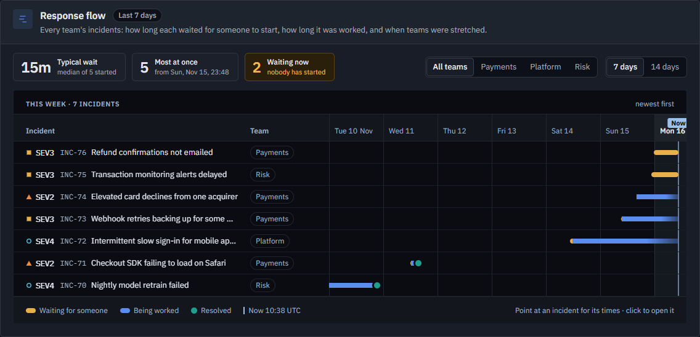

**Recent operational health** — *how often do things break, and where?* Incidents declared
per day over 30 days against a 7-day average, beside each service's share of them. The
service bars are deliberately neutral and drawn to their true share, never stretched to make
the busiest one look full.

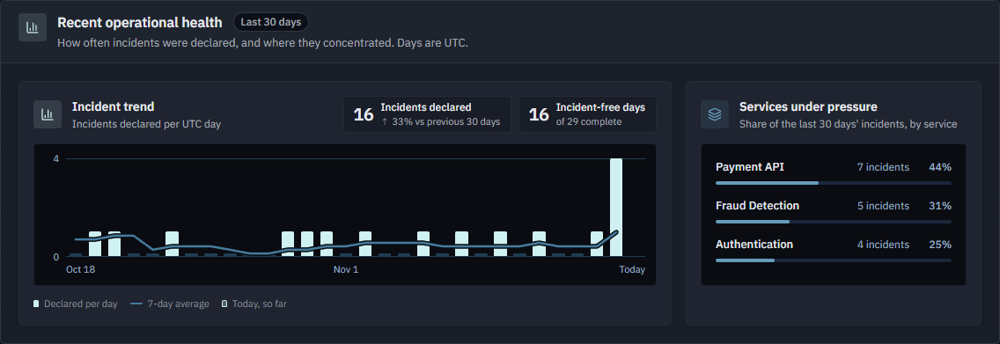

**Operational activity** — *what did this year look like?* Every day of the year by how
much incident response happened on it; select a day to see what happened.

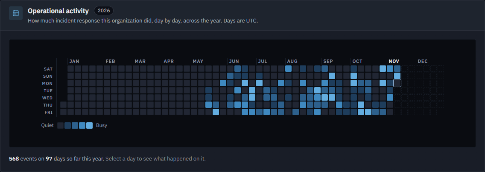

### Around the app

<table>
  <tr>
    <td width="50%" valign="top">
      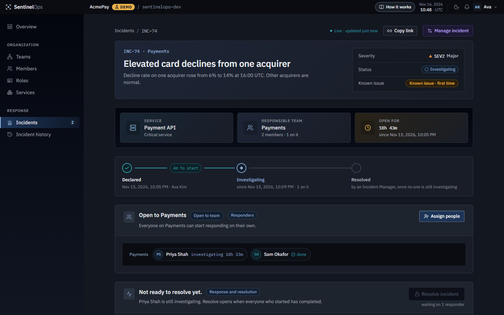
      <p><b>A live incident</b> — severity, owner team, time open, progress, and who is working it. Resolving stays locked until every responder has finished.</p>
    </td>
    <td width="50%" valign="top">
      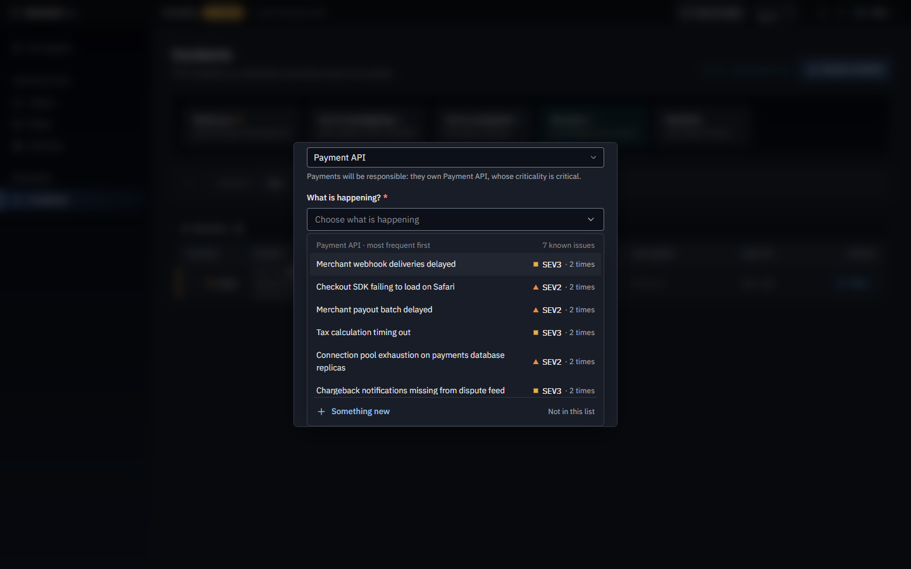
      <p><b>Declaring an incident</b> — pick the service, then a known issue it has had before (most frequent first), or something new.</p>
    </td>
  </tr>
  <tr>
    <td width="50%" valign="top">
      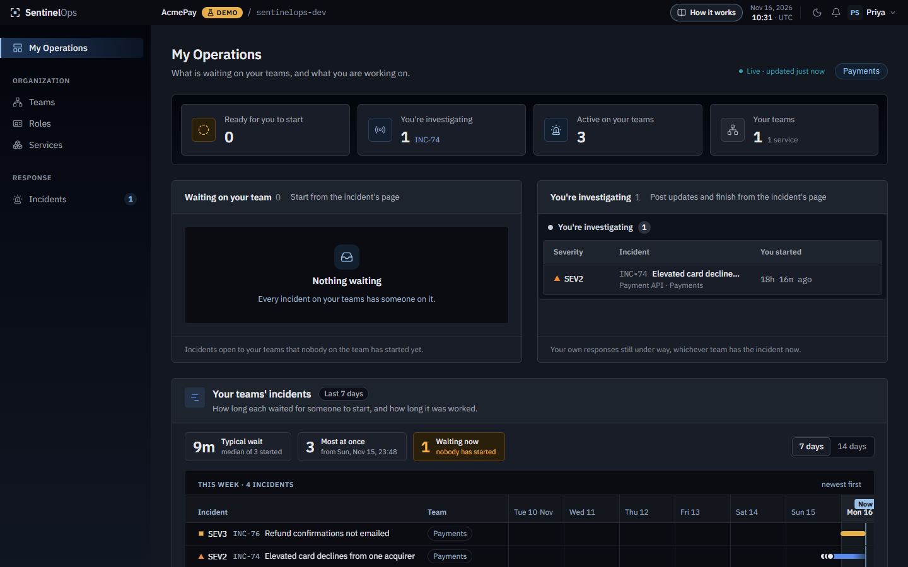
      <p><b>My Operations</b> — a responder's home: what is waiting on their team, what they are working on, and how their teams' week went.</p>
    </td>
    <td width="50%" valign="top">
      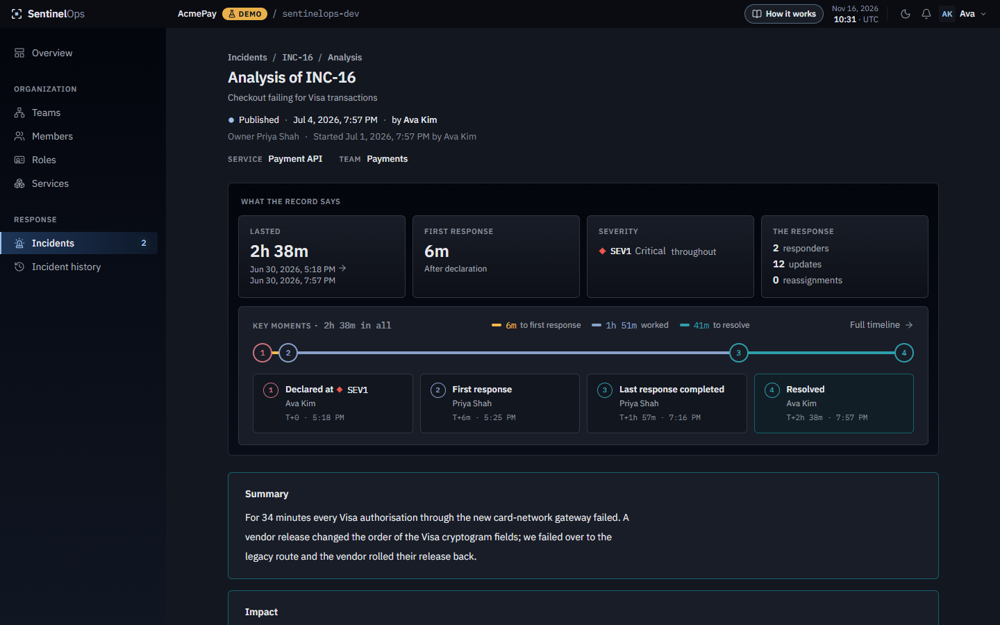
      <p><b>Post-incident analysis</b> — the facts and key moments are filled in from the record; people write the summary, impact, cause, and lessons.</p>
    </td>
  </tr>
  <tr>
    <td width="50%" valign="top">
      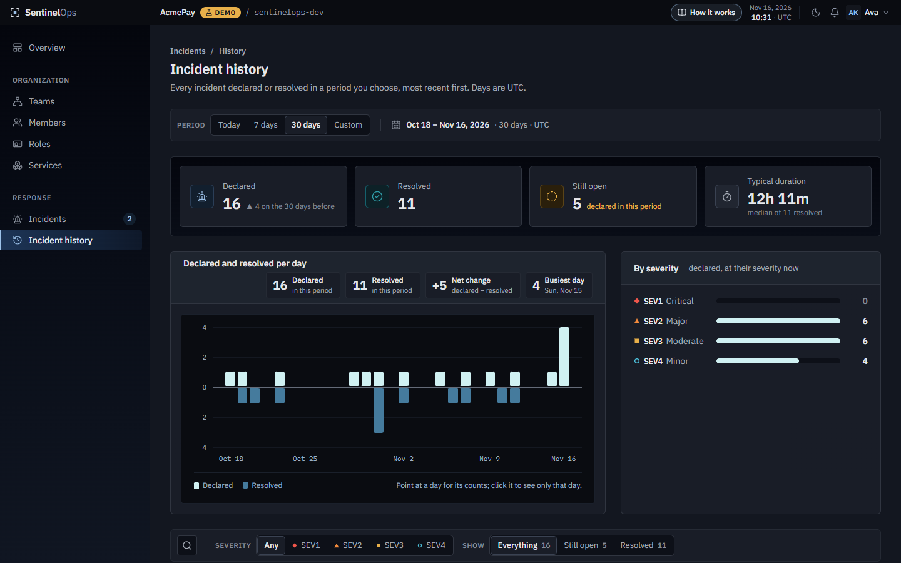
      <p><b>Incident history</b> — any period: what was declared and resolved each day, how long incidents typically last, and by severity.</p>
    </td>
    <td width="50%" valign="top">
      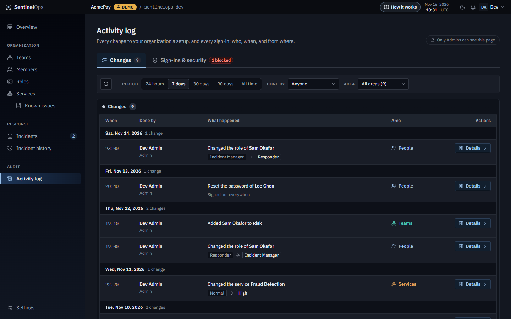
      <p><b>Activity log</b> — every change to the setup and every sign-in, including blocked password guessing. Admin only.</p>
    </td>
  </tr>
  <tr>
    <td width="50%" valign="top">
      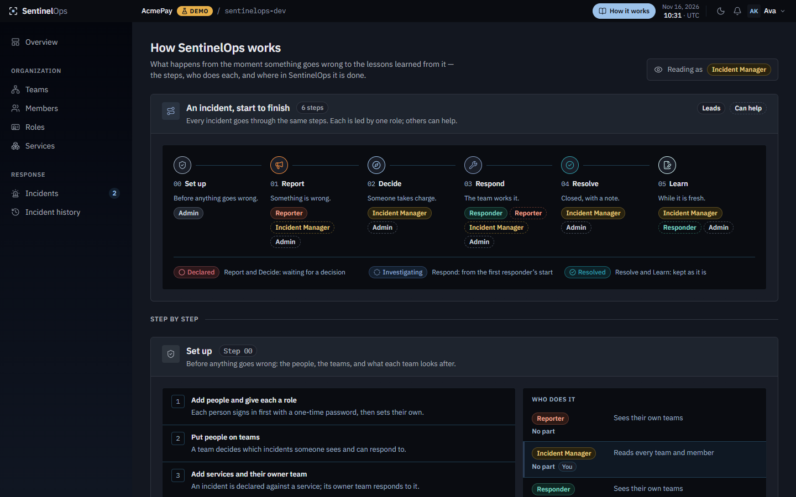
      <p><b>How it works</b> — the incident journey inside the app, read from the viewer's own role.</p>
    </td>
    <td width="50%" valign="top">
      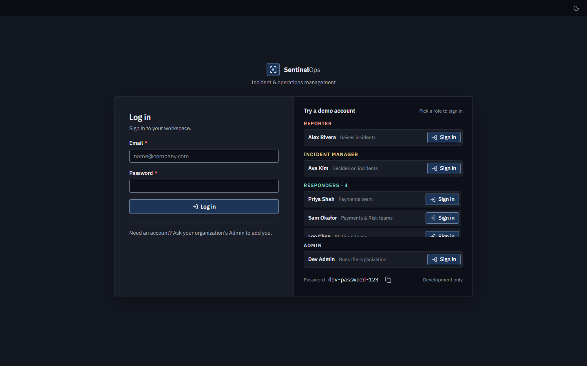
      <p><b>Sign-in</b> — with one-click demo accounts for each role in local development.</p>
    </td>
  </tr>
</table>

### Light and dark

Both themes are built from the same semantic design tokens, with WCAG AA contrast checked
in each by the test suite. The theme follows the system, or can be chosen in the top bar.

<table>
  <tr>
    <th width="50%">Dark</th>
    <th width="50%">Light</th>
  </tr>
  <tr>
    <td></td>
    <td>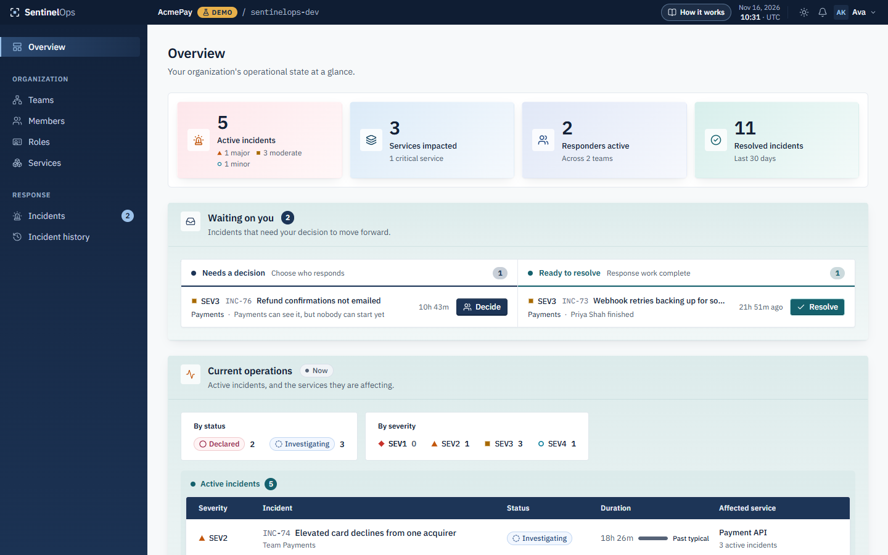</td>
  </tr>
  <tr>
    <td></td>
    <td>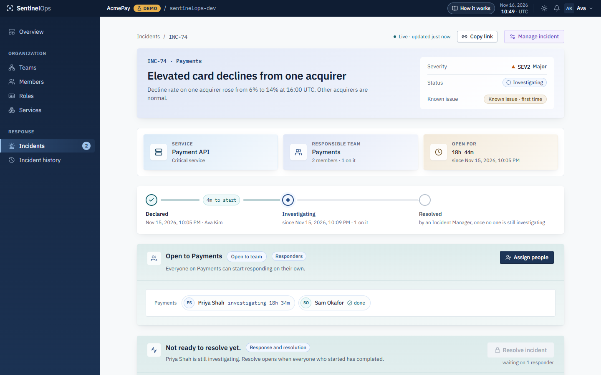</td>
  </tr>
  <tr>
    <td></td>
    <td>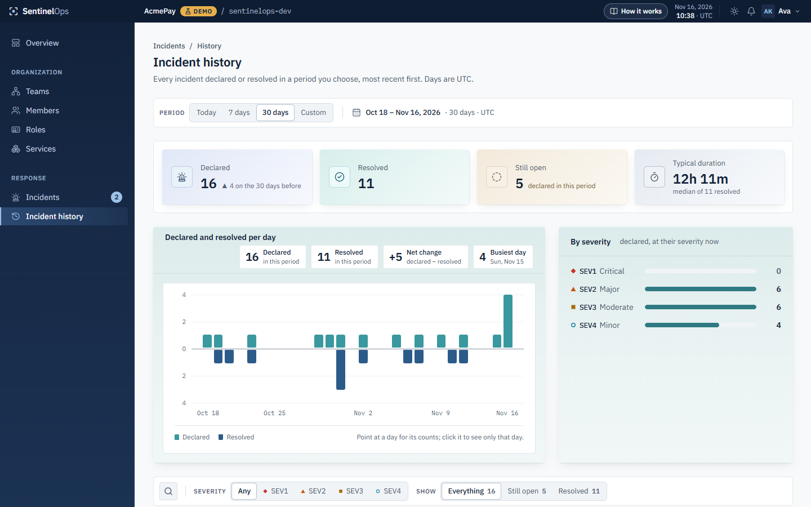</td>
  </tr>
  <tr>
    <td></td>
    <td>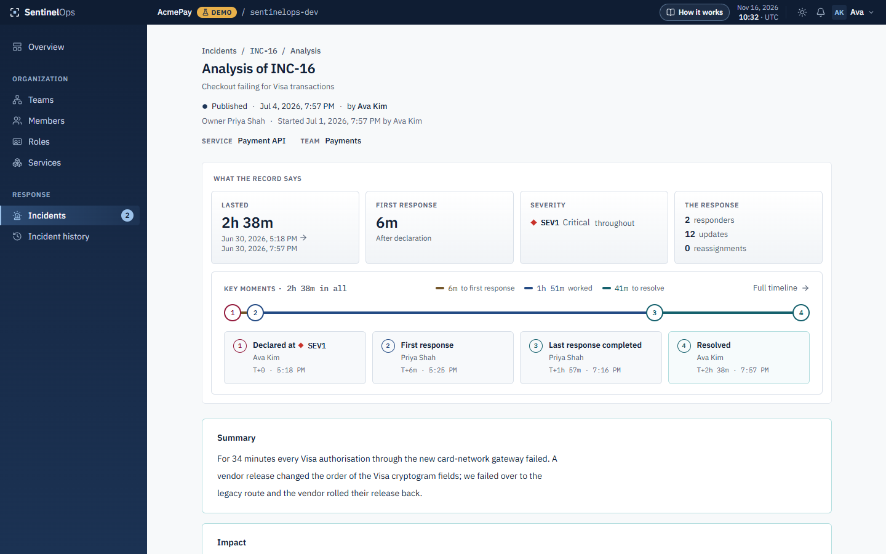</td>
  </tr>
</table>

### Design decisions

- **One meaning per color.** Severity has its own signal colors, each paired with a
  distinct shape (◆ ▲ ■ ○) so it never relies on color alone. On every response timeline,
  amber means *waiting*, blue *being worked*, and teal *resolved*. Classifications people choose, such as a
  service's criticality, stay neutral.
- **No two charts answer the same question.** Every section earns its place; counts may
  repeat in a tile, but a measure is charted once.
- **Honest proportions and horizons.** Bars show true shares. Each section names its time
  horizon — *Now*, *Last 30 days*, *2026* — rather than a vague "live".
- **Each action has one home.** Deciding and resolving happen on the Overview and the
  incident; detail pages read rather than duplicate buttons.
- **Two themes, one token system.** Every color is a semantic token defined for light and
  dark, and the test suite checks WCAG AA contrast in both.

## Engineering highlights

- **Tenant isolation in three layers.** Every request is admitted to an organization,
  authorized against a permission, and every query is scoped to the organization. Composite
  foreign keys make cross-organization links impossible in the database itself.
- **Closed by default.** Every route requires authentication unless explicitly marked
  public, and an organization route without a declared permission fails closed.
- **Sessions done carefully.** Short-lived access tokens; refresh tokens stored only as
  hashes, rotated on every use, with reuse detection that revokes the stolen token's whole
  family.
- **Brute-force limits.** Failed sign-ins are limited per email address and per client
  address, with a `Retry-After` header and nothing revealed about which accounts exist.
- **One error shape.** Every failure — validation, business rule, unknown route, crash —
  returns the same JSON contract with a stable `code` and a `requestId`.
- **Observable.** Structured JSON logs carry the request id, user, and organization on
  every line, with secrets redacted at the single output point.
- **Tested.** About 4,400 automated tests: API unit, end-to-end, and integration suites
  (against a real PostgreSQL), and web component and accessibility tests — all run in CI.

More in [docs/architecture.md](docs/architecture.md) and [docs/security.md](docs/security.md).

## Tech stack

| Layer | Choice |
| --- | --- |
| Web app | Next.js 16 (App Router), React 19, Tailwind CSS 4, TanStack Query |
| API | NestJS 12 on Express 5, Zod 4 validation |
| Database | PostgreSQL 18, Prisma 7 |
| Auth | JWT access tokens + rotating refresh cookies, Argon2id passwords |
| Testing | Vitest, Testing Library, Supertest, axe-core |
| Tooling | pnpm workspaces, Docker Compose, GitHub Actions, oxlint, ESLint, Prettier |

## Roles

| Role | Job | Can |
| --- | --- | --- |
| **Admin** | Sets the organization up | Manage people, roles, teams, services, and known issues; read the activity log; everything an Incident Manager can do |
| **Incident Manager** | Takes charge of incidents | See every incident; confirm severity; choose who responds; resolve; start analyses |
| **Reporter** | Raises incidents | Declare incidents, suggest a severity, and follow what they reported |
| **Responder** | Works the response | Start, update, and complete their response on their teams' incidents; write analyses they own |

Every API route declares the one permission it needs, and the role-to-permission table is
written out in a single file. The full matrix is in [docs/security.md](docs/security.md#roles-and-permissions).

## Getting started

**You need:** Node.js 22, pnpm 11 (`corepack enable`), and Docker.

```bash
git clone https://github.com/jui-dev/SentinelOps.git
cd SentinelOps
pnpm install

# Configuration — the templates work as they are for local development
cp .env.example .env
cp apps/web/.env.example apps/web/.env.local

# Database
pnpm db:up
pnpm --filter @sentinelops/api prisma:migrate
pnpm --filter @sentinelops/api prisma:generate

# API on http://localhost:3001 and web app on http://localhost:3000
pnpm dev
```

Open **<http://localhost:3000>** (use `localhost`, not `127.0.0.1`).

In development the API sets up a sample organization, **AcmePay**, and the sign-in page
lists its people for a one-click sign-in. Every account's password is `dev-password-123`.

| Sign in as | Role | To see |
| --- | --- | --- |
| `admin@example.com` | Admin | Setup, the activity log, and the demo workspace |
| `ava@example.com` | Incident Manager | The Overview, deciding, and resolving |
| `alex@example.com` | Reporter | Declaring an incident |
| `priya@example.com` | Responder | *My Operations* and working a response |

To fill it with 26 weeks of incidents, open **Settings › Demo workspace** as the Admin
and choose *Reset demo*, or run:

```bash
pnpm --filter @sentinelops/api demo -- reset
```

Full setup, every environment variable, and the demo commands are in
[docs/development.md](docs/development.md).

## Running the checks

```bash
pnpm typecheck
pnpm lint
pnpm test                                        # API unit + web tests, no database
pnpm --filter @sentinelops/api test:e2e          # API end-to-end, no database
pnpm --filter @sentinelops/api test:integration  # needs pnpm db:up
pnpm build
```

## Project structure

```
SentinelOps/
├── apps/
│   ├── api/        NestJS API — modules per domain, Prisma schema and migrations
│   └── web/        Next.js web app — App Router pages and feature components
├── docker/         Docker Compose for local PostgreSQL
├── docs/           Architecture, security, data model, and development guides
└── .github/        CI workflow
```

## Documentation

| Guide | Covers |
| --- | --- |
| [Development](docs/development.md) | Setup, configuration, the demo workspace, tests, and CI |
| [Architecture](docs/architecture.md) | How the apps fit together, request handling, API conventions, logging |
| [Security](docs/security.md) | Authentication, tenancy, roles and permissions, and known gaps |
| [Data model](docs/data-model.md) | The tables, how tenants are kept apart, and deletion rules |
| [Web app](apps/web/README.md) | Working on the front end: layout, UI foundation, sessions |

## Limitations

SentinelOps is a portfolio project, and some things a production incident tool would have
are deliberately out of scope for now:

- **No detection or paging.** Incidents are declared by people; there are no monitoring
  integrations, alerts, or on-call schedules.
- **No email.** Notifications are in the app only, and people are added by an Admin with a
  one-time password rather than invited by email.
- **Polling, not push.** Live views refresh every 15–30 seconds rather than over WebSockets.
- **One API instance.** Sign-in limits are counted in memory, which is right for a single
  instance; several would need a shared store.
- **Organizations are created by the operator.** Public sign-up is off by default.

## License

[MIT](LICENSE) © 2026 jui-dev
