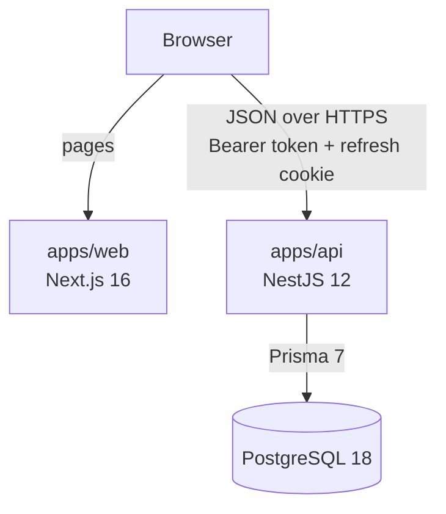

# Architecture

How SentinelOps is put together: the two applications, how a request travels through
the API, and the conventions every part of it follows.

- [Overview](#overview)
- [The API](#the-api)
- [API conventions](#api-conventions)
- [Logging](#logging)
- [The web app](#the-web-app)
- [Deployment constraint: one site](#deployment-constraint-one-site)

## Overview



A pnpm monorepo with two deployable applications. The web app's pages run in the browser
and call the API directly — there is no backend-for-frontend or proxy between them. All
state lives in PostgreSQL; there is no cache or queue to keep consistent with it.

## The API

`apps/api` is a NestJS application, one module per domain:

| Module | Owns |
| --- | --- |
| `auth` | Sign-in, sessions, passwords, sign-in limits |
| `tenancy`, `authorization` | Admitting a request to an organization, and checking its permission |
| `organizations` | The organization and its members: adding, roles, password resets, removal |
| `teams`, `services`, `known-issues` | The organization's setup |
| `incidents` | Declaring, deciding, responding, resolving, the timeline, history and analytics |
| `incident-analyses` | Post-incident analyses |
| `notifications` | In-app notifications, written in the same transaction as the change they report |
| `activity` | The activity log of setup changes and sign-ins |
| `invitations` | Invitation links (switched off by default) |
| `health` | Liveness and readiness probes |
| `dev` | The demo workspace — development only |

### A request's path

1. **`RequestIdMiddleware`** assigns a request id and opens the request context
   (`AsyncLocalStorage`), so everything after it can log with that id.
2. **`JwtAuthGuard`** — global, so every route is closed unless marked `@Public()` —
   verifies the access token and records the user id. No database read.
3. **`OrganizationMembershipGuard`** reads `:organizationId` from the path, looks up the
   caller's current membership, and records the organization and role. A non-member gets
   `404`, exactly as for an organization that does not exist.
4. **`OrganizationPermissionGuard`** checks that role against the one permission the
   handler declares with `@RequirePermission()`. No database read.
5. **Validation** — the body, query, and params are parsed by Zod schemas.
6. **The service** receives `organizationId` as an explicit argument and puts it in the
   `where` clause of every query.

The organization is named by the route and nothing else — never by a header, query
string, or body. See [security.md](security.md#tenancy) for why each layer exists.

### Configuration

The environment is validated once at boot by a Zod schema and exposed as typed
configuration domains (`app`, `database`, `logging`, `auth`, `features`). Application code
injects a domain by token rather than reading `process.env`, so each variable is named in
exactly one place. A bad value stops the boot before the server listens. The variables
are listed in [development.md](development.md#configuration).

## API conventions

### Responses

A successful response is the resource itself, with no `{ data: … }` envelope. Responses
are built by explicit mappers that name every field — a Prisma model is never returned or
spread into a response — so a column added later cannot leak by accident.

### Errors

Every non-2xx response — a validation failure, a business rule, an unknown route, or a
crash — has one shape, built in one place
([`all-exceptions.filter.ts`](../apps/api/src/common/all-exceptions.filter.ts)):

```jsonc
{
  "statusCode": 409,
  "error": "Conflict",
  "message": "This incident is already resolved.",
  "code": "INCIDENT_RESOLVED",          // stable, for clients to branch on
  "details": [                          // only for field-level validation failures
    { "field": "title", "message": "Too small: expected string to have >=1 characters" }
  ],
  "requestId": "0f9c1e2a-…",
  "timestamp": "2026-11-16T10:15:00.000Z",
  "path": "/api/v1/organizations/…/incidents/…"
}
```

- `message` is always a string; field-level problems go in `details`.
- Anything that is not a deliberate HTTP error becomes a generic `500`. The real error and
  stack are logged, never sent.
- `requestId` is also in the `X-Request-Id` header and on every log line for the request,
  which ties a user's error report to the server's record of it.
- A `429` carries a `Retry-After` header.

### Validation

Zod 4 schemas, through NestJS 12's built-in Standard Schema pipe — no `class-validator`.
Write bodies are strict objects, so an unexpected key (such as `organizationId` or `role`)
is a `400` rather than silently ignored. Submitted values are never echoed back in an
error.

### Concurrency

Rules that depend on other rows — "the organization keeps at least one Admin", "an
incident resolves only when no responder is still working" — are checked inside a
transaction that locks the rows they read, so two requests racing cannot both pass. The
integration suite runs these races against PostgreSQL.

## Logging

The API logs through NestJS's own `Logger`, backed by one application logger
([`app.logger.ts`](../apps/api/src/logger/app.logger.ts)) installed in `main.ts`.

- **Formats:** `json` — one line per entry, for production — or `pretty` for development.
- **Ambient fields:** every line written during a request carries `requestId`, then
  `userId` once the token is verified, then `organizationId` once the request is admitted.
  No call site passes them along.
- **Two records per failed request:** an access line (`method`, `path`, `statusCode`,
  `durationMs`) and a diagnostic line from the exception filter, sharing one `requestId`.
- **Sensitive data:** request bodies, response bodies, and headers are never logged, and
  neither is free text a user wrote. As a backstop, every structured field passes through
  [`redact.ts`](../apps/api/src/logger/redact.ts), which masks any key that looks like a
  password, token, secret, cookie, or similar — in both formats and at every level.

## The web app

`apps/web` is a Next.js 16 App Router application. Pages live under
`src/app/(app)/orgs/[orgSlug]/…`; the feature components they render live in
`src/components/<feature>/`. Server state is held by TanStack Query, and every API call
goes through one typed client
([`src/lib/api`](../apps/web/src/lib/api)) whose contracts mirror the API's responses.

### Sessions in the browser

| | Access token | Refresh token |
| --- | --- | --- |
| Held in | Memory, per tab | The API's `HttpOnly` cookie — script never reads it |
| Survives a reload | No — restored by a refresh on load | Yes |
| Sent with | Authenticated requests, as `Authorization: Bearer` | Only sign-in, refresh, and sign-out |

A `401` triggers at most one refresh and one retry. Because the API revokes a whole token
family when a refresh token is used twice, refreshes never overlap: one at a time within a
tab, and across tabs through an exclusive Web Lock.

### What a page offers

The API tells the web app the caller's permissions in their organization. The app uses
them to decide what to *show* — a button, a link, a page in the navigation — never what is
*allowed*: every request is still checked by the API.

### Staying current

Views that change while an incident runs refresh themselves by polling: a live incident
every 15 seconds, the lists of what needs attention and the notification bell every 30.
There are no WebSockets.

### UI foundation

Colors, type, and spacing are semantic design tokens with light and dark themes. Shared
primitives live in `src/components/ui/`. The test suite checks color contrast and runs
axe-core over the pages. Details are in [`apps/web/README.md`](../apps/web/README.md).

## Deployment constraint: one site

The refresh cookie is `SameSite=Lax`, so the browser only sends it when the web app and
the API are on the **same site** — the same scheme and registrable domain:

| Web app | API | Works |
| --- | --- | --- |
| `http://localhost:3000` | `http://localhost:3001` | Yes — the port does not change the site |
| `https://app.example.com` | `https://api.example.com` | Yes |
| `http://127.0.0.1:3000` | `http://localhost:3001` | No — different sites |
| `https://sentinelops.vercel.app` | `https://sentinelops-api.onrender.com` | No — each is its own site under a public suffix |

`CORS_ORIGIN` on the API must list the web app's exact origin, and `NEXT_PUBLIC_API_URL`
on the web app names the API. Behind a load balancer, set `TRUST_PROXY_HOPS` — see
[security.md](security.md#sign-in-limits).
