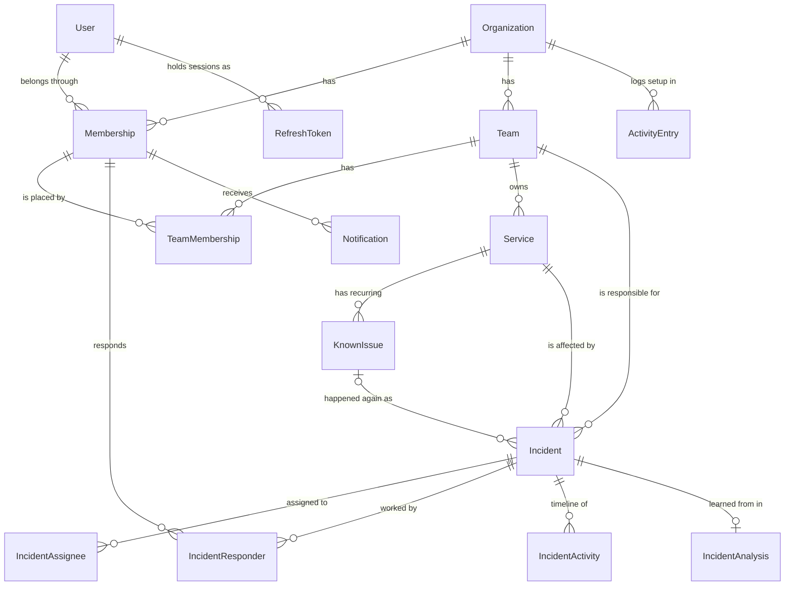

# Data model

The PostgreSQL schema behind SentinelOps: what is stored, how organizations are kept apart
inside the database itself, and what happens when something is deleted. The source of
truth is [`apps/api/prisma/schema.prisma`](../apps/api/prisma/schema.prisma), which
documents every table and column.

- [Entities](#entities)
- [People and organizations](#people-and-organizations)
- [Incidents](#incidents)
- [Keeping tenants apart](#keeping-tenants-apart)
- [Deleting and retiring](#deleting-and-retiring)
- [Conventions](#conventions)
- [Migrations](#migrations)

## Entities

| Area | Tables |
| --- | --- |
| Identity | `users`, `refresh_tokens` |
| Organizations | `organizations`, `memberships`, `invitations`, `demo_workspaces` |
| Setup | `teams`, `team_memberships`, `services`, `known_issues` |
| Incidents | `incidents`, `incident_assignees`, `incident_responders`, `incident_activities`, `incident_analyses` |
| Awareness | `notifications`, `activity_entries` |

## People and organizations

A **user** is global: one row per person, one email, one password. Belonging to an
organization is a **membership**, which carries the person's role there; a person has at
most one membership per organization.

A **team** groups members. Belonging to a team is what decides which incidents a responder
sees and can work, so a member may be on several teams or none. A **service** is something
the organization runs, owned by exactly one team and classified by criticality. A **known
issue** is a recurring problem on one service.

## Incidents

An **incident** is declared against a service, and the service's owner team becomes
responsible. It is numbered per organization (`INC-1`, `INC-2`, …) — the number is how the
API and the web app address it.

- `status`: `DECLARED` → `INVESTIGATING` → `RESOLVED`. Forward only; a resolved incident
  is kept as it is.
- `severity`: `SEV1`–`SEV4`. A Reporter's severity is a suggestion until an Incident
  Manager confirms it.
- `responseAccess`: `OPEN` to the responsible team, or limited to named
  **assignees**.
- Each responder's work is an **incident responder** row — investigating, then complete —
  so the incident can be resolved only once everyone who started has finished.
- The **timeline** is its incident activities: the declaration, every update, every
  change of severity, status, team, or who may respond, and each responder starting and
  completing.
- An incident has at most one **analysis**, owned by one member, written in sections and
  then published.

**Notifications** are written in the same transaction as the change they report, so
there is never a change without its notification or the other way round.
**Activity entries** record changes to the organization's setup and sign-ins.

## Keeping tenants apart

Every tenant-owned table carries `organization_id`, and every query filters on it. The
database enforces it too: when one tenant-owned row points at another, the foreign key
**includes `organization_id`**.

For example, a `team_memberships` row references `teams(organization_id, id)` and
`memberships(organization_id, id)` through its own single `organization_id`. Both rows it
joins must therefore be in the same organization as each other — a team member from
another organization cannot be stored, however the row is written, raw SQL included. The
same pattern holds a service to its owner team, an incident to its service, team, and
known issue, responders, assignees, and analyses to their incident and member, and
notifications to their recipient.

The extra `UNIQUE (organization_id, id)` on the referenced tables exists only because a
composite foreign key must reference a unique constraint over exactly its columns.

Users are the one exception: they are global, so no composite key can hold one to an
organization. Where a row records a user — who declared an incident, who wrote an update —
the API takes that user from the admitted request inside the same transaction, never from
the request body.

This is the backstop, not the mechanism: the service code still scopes every query, and
the integration suite proves both against a real database with two tenants side by side.

## Deleting and retiring

Configuration can be retired, but **history is never deleted from under the records that
name it**.

| Entity | What "removing" does |
| --- | --- |
| Organization, User | **Soft delete** — `deleted_at` is set; every read filters it out |
| Membership | **Soft removal** — `removed_at` is set; access ends, past work stays attributed. Restorable |
| Team | Deleted, with its placements — refused while it owns a service or has ever been responsible for an incident |
| Service | **Archived** — kept for the incidents that name it, refused for new ones. Deleted only if no incident names it |
| Known issue | **Archived** — kept for the incidents linked to it |
| Incident, timeline, analysis | **Kept** — never deleted |
| Invitation | Kept — accepted or revoked |

The refusals are `ON DELETE RESTRICT` foreign keys, so they hold for raw SQL too.
`ON DELETE CASCADE` exists only for the physical removal of a whole organization or user —
an erasure request or a local reset — which PostgreSQL completes in one statement.

## Conventions

| Convention | Why |
| --- | --- |
| `snake_case` tables and columns | Raw SQL and `psql` read naturally without quoting |
| UUIDv7 primary keys in `uuid` columns | 16 bytes instead of a 36-character string, and time-ordered, so inserts stay local in the index |
| `timestamptz(3)` for every timestamp | Prisma's default `timestamp` has no time zone |
| `text` for strings | Length limits live in the Zod schemas at the API boundary |
| Foreign keys indexed | Wherever no other index already leads with them, including the ones that serve the `RESTRICT` checks |
| Uniqueness by constraint, not by checking first | A read-then-write check races; the violation is caught and turned into a `409` |

## Migrations

The migration history is in
[`apps/api/prisma/migrations/`](../apps/api/prisma/migrations), starting from
`init_core_domain`. Migrations are written by `prisma migrate dev` and reviewed as SQL;
data-changing migrations — such as merging the old `OWNER` role into `ADMIN` — rewrite
existing rows in the same migration. See [development.md](development.md#database-and-migrations)
for the commands.
